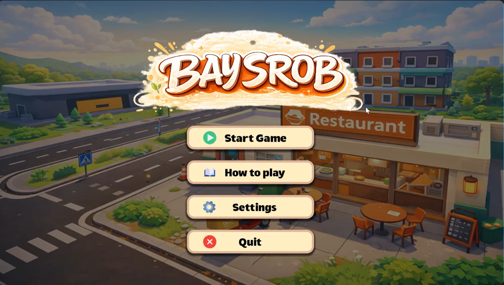

# 3D-Game
Apply Object-Oriented Programming (OOP)  Build an interactive game using Godot  Create a fun Cambodian-style gameplay experience

# BaySrob

A 3D restaurant simulation game built with Godot Engine, inspired by games such as Pizza Ready and Good Pizza, Great Pizza. Players serve Cambodian food, earn money, level up, unlock new equipment, and manage customer orders in a fun and interactive environment.

## Demo Screenshot

  

---

## Demo Video

Watch the gameplay demo here:

[▶️ Watch Demo Video](https://github.com/Sotheany-web/3D-Game/blob/main/3Dgame_video.mp4)

Or download the video directly:

[📥 Download Demo](https://raw.githubusercontent.com/Sotheany-web/3D-Game/main/3Dgame_video.mp4)

## Project Overview

BaySrob is a single-player restaurant management game developed as an Object-Oriented Programming (OOP) project. The game combines cooking, customer service, progression systems, AI behavior, and persistent data storage into a complete simulation experience.

### Objectives
- Apply Object-Oriented Programming concepts in a real-world project
- Build an interactive 3D game using Godot
- Create a Cambodian-themed restaurant simulation
- Demonstrate software design principles in game development

---

## Features

- 🍚 Cooking and serving system
- 🚶 Customer queue management
- 🚗 Drive-through ordering system
- 💰 Money and reward system
- ⭐ Level progression system
- 🛒 Shop and upgrade system
- 🔊 Audio and settings controls
- 💾 Save and load game progress
- 🤖 Customer AI behavior

---

## Gameplay

Players take customer orders and prepare Cambodian-inspired food and drinks.

The gameplay loop includes:

1. Receive customer orders
2. Prepare food or drinks
3. Deliver items to customers
4. Earn money and stars
5. Level up
6. Unlock new machines and upgrades
7. Continue expanding the restaurant

---

## OOP Concepts Implemented

### Singleton Pattern
- Global `GameManager` accessible from all scenes
- Stores money, stars, levels, and owned items

### Observer Pattern
- Uses Godot signals
- UI automatically updates when data changes

### Encapsulation
- Game data is managed through GameManager methods
- Prevents unauthorized modification of player data

### Inheritance
- Reuses built-in Godot classes
- Extends classes such as `CharacterBody3D` and `PathFollow3D`

### Polymorphism
- Different game objects implement shared methods
- Flexible behavior across systems

### Abstraction
- Complex game logic is hidden behind simple interfaces
- Other systems interact through functions

### Composition
- Game objects are built from multiple independent components
- Encourages modular and reusable design

### Defensive Programming
- Null checking and safe node access
- Prevents runtime crashes

---

## Challenging Systems

### Serving Logic
- Item pickup system
- Item identification system
- Item consumption system
- Customer order validation
- Reward distribution

### Save & Load Manager
- JSON serialization
- JSON deserialization
- Persistent game storage
- Scene restoration
- State management

---

## Technologies Used

### Game Engine
- Godot Engine

### 3D Modeling
- Blender

### Programming Language
- GDScript

### Data Storage
- JSON

---

## Team Members

### Sotheany Van
- Environment design
- Customer behavior system
- Cooking logic
- Camera system
- Player movement
- Data storage
- Audio player

### Samreth Rangsey
- Menu and shop system
- Scoring and progression
- GameManager
- Item holding system
- UI implementation
- Character animation
- Audio system

---

## Screenshots

Add screenshots of:
- Main menu
- Gameplay
- Shop system
- Drive-through system

---

## Future Improvements

- More Cambodian dishes
- Additional restaurant upgrades
- Enhanced customer AI
- More levels and challenges
- Achievement system
- Mobile support
- Multiplayer support

---

## References

- Brackeys - How to Make 3D Games in Godot
- Godot Engine Documentation
- Blender Documentation

---

## Academic Information

Course: Object-Oriented Programming (OOPR019)

Institute of Technology of Cambodia (ITC)

Academic Year: 2025–2026

Instructor: Mr. HOK Tin

---

## License

This project was developed for educational purposes as part of an Object-Oriented Programming course project.
